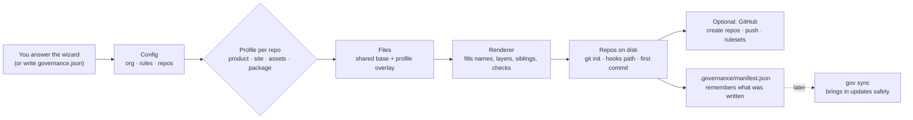

<div align="center">

# Repo Governance

### Every repo set up the same way, and kept that way.

**Docs, CI gates, git hooks, branch rulesets and coding-agent instructions for every repository in your organisation, from one command.**

[](LICENSE)
[](CHANGELOG.md)
[](package.json)
[](package.json)

**[Usage guide](docs/usage.md)** · **[Concepts](docs/concepts.md)** · **[Changelog](CHANGELOG.md)**

[Quick start](#quick-start) · [What you get](#what-you-get) · [See it work](#see-it-work) · [How it works](#how-it-works) · [Keeping repos current](#keeping-repos-current) · [FAQ](#faq) · [Documentation](#documentation)

</div>

<br />

Most teams write engineering standards and hope people follow them. Then the second repo copies the first and drifts, a PR skips its docs, someone pushes straight to `main`, and a coding agent edits the wrong repository because nothing told it which one owns the fact.

`repo-governance` generates the standards **and** the machinery that enforces them:
- layered docs (`L0`–`L7`) where every document is registered;
- a CI gate that blocks a merge when docs are unregistered, stale or missing headers;
- git hooks for Conventional Commits and secret scanning;
- GitHub rulesets: PR-only, required checks, and `main` only ever receives `develop`;
- `CLAUDE.md`, a skill, slash commands and a session hook that make coding agents follow the same rules as people;
- sibling awareness: each repo knows which repo owns which fact, and which way changes flow.

It is one Node script with no dependencies. Answer a few questions and you get repos that pass their own gate from the first commit. Run `gov sync` later and they pick up improvements without losing your edits.

## Quick start

**You need** Node 20+, pnpm and git. The GitHub CLI (`gh`, logged in) is needed only if you want it to create the repos on GitHub for you.

```bash
git clone https://github.com/soupler-oss/repo-governance.git && cd repo-governance
pnpm generate        # the wizard: your org, your rules, your repos; nothing is written until you confirm
```

Then, in each generated repo:

```bash
cd ~/code/example-org/platform
bash bin/install-hooks.sh          # once per clone: commit-msg and pre-commit hooks
bash bin/statutory-integrity.sh    # the gate CI runs; a fresh repo already passes
```

Open that repo's `CLAUDE.md` and fill in the `TODO` lines (what the product is, the stack, the apps map). Coding agents find their way around the repo using those lines.

> Prefer a config file to a wizard? Copy [`examples/new-org.governance.json`](examples/new-org.governance.json), edit it, and run `node bin/gov.mjs new-org ~/code/my-org --config my-org.json --dry-run`. Every question is explained in [the wizard guide](docs/wizard.md).

## What you get

| | |
|---|---|
| **Layered docs** | `docs/L0 … L7`: standards, strategy, product, design, architecture, infrastructure, operations, remediation, execution evidence, forensics. Every layer has a registry. |
| **A gate that blocks the merge** | `Statutory Integrity` fails a PR if any doc is unregistered (subfolders included), any registry row is stale, or a header is incomplete. |
| **Git conventions, enforced** | Conventional Commits and optional no-AI-attribution via a `commit-msg` hook; secret scanning before each commit and in CI. |
| **One promotion path** | feature → `develop` → `main`, and *only* `develop` may open a PR into `main`. Rulesets plus a CI check, because rulesets alone can't see a PR's source branch. |
| **PRs that carry their docs** | The PR template's `## Docs update` block (`UPDATED` / `EXEMPT` + notes) is checked by CI. Left blank, it fails. |
| **Agent instructions** | A governance-first `CLAUDE.md` for each repo type, a `doc-governance` skill, slash commands and a session-start hook. |
| **Multi-repo awareness** | Each repo knows its siblings, which repo owns which fact, and which way changes flow. |
| **Safe updates** | `gov sync` brings generator improvements into existing repos and never overwrites a file you edited. |

## See it work

A repo generated from [`examples/new-org.governance.json`](examples/new-org.governance.json), straight after `gov new-org`:

```console
$ bash bin/statutory-integrity.sh
[SIVE] auditing 7 layer(s)
[SIVE] SUCCESS: 100% statutory compliance verified.
```

Add a doc without registering it, and the merge is blocked:

```console
$ bash bin/statutory-integrity.sh
[SIVE] auditing 7 layer(s)
[SIVE] FAIL: docs/L3-architecture/L3-099-cache-strategy-v1.md: not registered in L3-000-artifact-registry-v1.md

[SIVE] FAILURE: repository is out of statutory compliance. Merge is blocked.
```

A commit message that isn't a Conventional Commit never gets made:

```console
$ git commit -m "fixed stuff"
               got:      fixed stuff
               expected: type(scope): short imperative description
               types:    feat fix docs chore tech infra refactor test ci build perf release
```

And a later `gov sync` updates what you haven't touched, and leaves what you have:

```console
$ node bin/gov.mjs sync ~/code/example-org/platform
platform (from template v1.2.2 → v1.2.2)
  unchanged  18
  skipped    34
  CONFLICTS  1 — you edited these; review the .governance-new file next to each:
             bin/governance-brief.sh
```

## How it works



Each repo gets a **profile**, chosen by what the repo is:

| Profile | Use it for | Doc layers |
|---|---|---|
| **`product`** | The main codebase: apps, services, shared packages. Usually holds the org's L0 standards | L0–L5 *(+ L6, L6.1, L7 if regulated)* |
| **`site`** | A public website. Points at the standards repo instead of copying L0 | L3 *(+ L6, L6.1, L7 if regulated)* |
| **`assets`** | Brand and static media; the source of truth for logos, palette and fonts | none |
| **`package`** | Shared content or a library that other repos pin by tag | none |

Generated repos have no runtime dependency on `repo-governance`: they carry their own gate, hooks and workflows. The layers, the change flow and every enforcement mechanism are explained in [Concepts](docs/concepts.md).

## Keeping repos current

```bash
node bin/gov.mjs add-repo mobile-kit --profile package --org-dir ~/code/example-org   # every sibling's topology refreshes
node bin/gov.mjs sync ~/code/example-org/platform --check   # exit 1 on drift; good for a scheduled job
node bin/gov.mjs sync ~/code/example-org/platform           # bring in updates; never overwrites your edits
node bin/gov.mjs adopt ~/code/my-repo --config governance.json --repo platform --dry-run   # add governance to an existing repo
node bin/gov.mjs github ~/code/example-org/platform         # create on GitHub, push, set default branch, apply rulesets
```

Nothing touches GitHub without showing you the plan and waiting for `y`. Every command and option is in the [usage guide](docs/usage.md).

## Status

**1.2.x**, used to run Soupler's own repositories. Every release is tested by generating real organisations and running their gates, hooks and `sync` (`pnpm test`). Release notes are in the [CHANGELOG](CHANGELOG.md).

- Branch rulesets need a public repo or a paid GitHub plan (Team/Pro) for private repos. On a free plan, everything else works and the generator tells you protection isn't enforced.
- Agent instructions are written for Claude Code. The gate, hooks, CI and rulesets work without it.
- Not published to npm yet: run it from a clone with `node bin/gov.mjs`.

## FAQ

<details>
<summary><strong>Who is this for?</strong></summary>

Teams with more than one repository who want the same standards in all of them, enforced rather than hoped for. It is especially useful when coding agents write part of your code, and in regulated work where you must prove how a defect was found and fixed (the optional L6–L7 layers).
</details>

<details>
<summary><strong>How is this different from a GitHub template repository or cookiecutter?</strong></summary>

A template repository is copied once and then forgotten. Cookiecutter and similar tools scaffold files. `repo-governance` also generates the **enforcement**: a CI gate, hooks and branch rulesets. It wires repos to each other (which repo owns which fact), and with `gov sync` keeps every repo current with later improvements without overwriting what your team changed.
</details>

<details>
<summary><strong>Do I need GitHub?</strong></summary>

No. Without the GitHub step everything is local files and git. Publishing is a separate step that you confirm.
</details>

<details>
<summary><strong>Will it overwrite my changes?</strong></summary>

No. Files the generator owns (hooks, workflows, the gate) are updated only if you haven't edited them; otherwise the new version is written next to yours as `<file>.governance-new`. Docs, `CLAUDE.md`, README and CHANGELOG are yours after the first write: only clearly marked regions, such as the sibling list, are refreshed.
</details>

<details>
<summary><strong>Can I add it to repos I already have?</strong></summary>

Yes, with `gov adopt`. The gate starts in *adoption mode*: unregistered docs fail, but header and stale-row findings are warnings, so you can switch CI on before cleaning up. Switch to strict mode when the registries are clean.
</details>

<details>
<summary><strong>What if I don't want a rule?</strong></summary>

`noAiAttribution` and `requireDocsUpdate` switch off in `governance.json`. Anything else you can delete after generating; `sync --check` will then report it as drift, which is the point.
</details>

## Documentation

- **[Usage guide](docs/usage.md)**: every command, publishing to GitHub, `sync`, adopting, and the `governance.json` reference
- **[The wizard, question by question](docs/wizard.md)**: a complete example run, with what each answer changes
- **[Concepts](docs/concepts.md)**: what gets generated, the documentation layers, how a change flows, how rules are enforced, how agents are kept on the rails
- **[Changelog](CHANGELOG.md)**

## Contributing

Issues and pull requests are welcome. Read [CONTRIBUTING.md](CONTRIBUTING.md) first, and [CLAUDE.md](CLAUDE.md) before changing anything: it explains the architecture, the file kinds and the rules for this repository. Branch from `develop` and open the pull request against `develop`; `main` only receives `develop`. Report security problems privately per [SECURITY.md](SECURITY.md).

```bash
pnpm test        # generates real orgs and runs their gates, hooks and sync
pnpm generate    # run the wizard
```

## License

Copyright 2026 Soupler. [Apache License 2.0](LICENSE); see also [`NOTICE`](NOTICE). Contributions are accepted under the same licence. **What you generate is yours:** the licence places no restriction on the repositories and documents the generator produces. The licence doesn't grant use of the Soupler name or logo.
