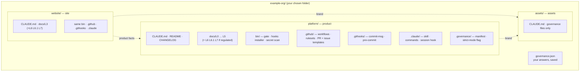
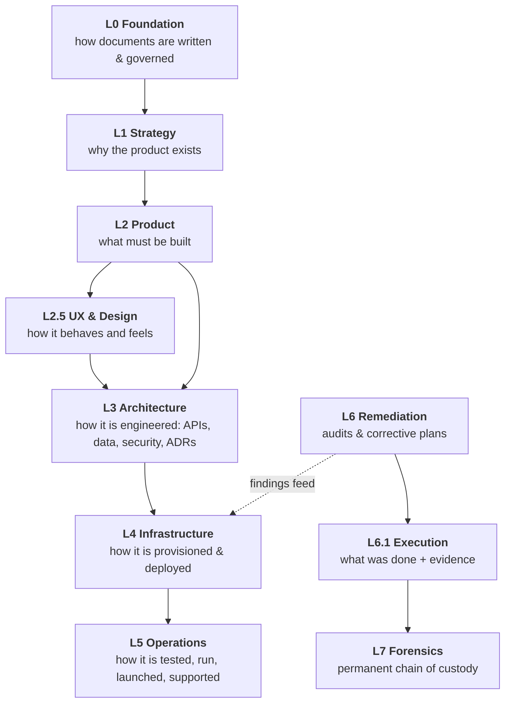
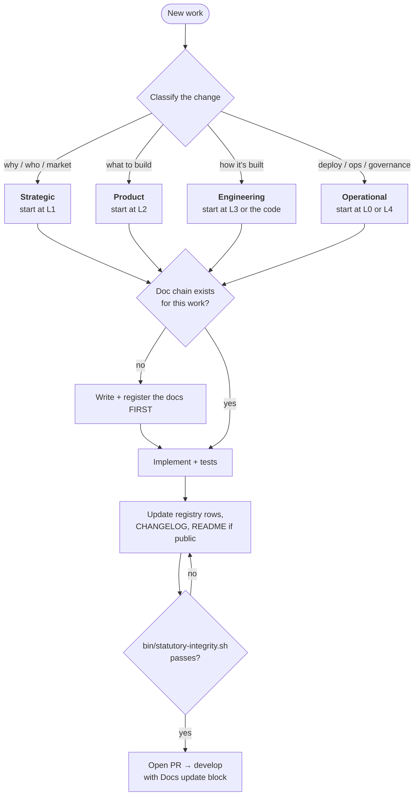
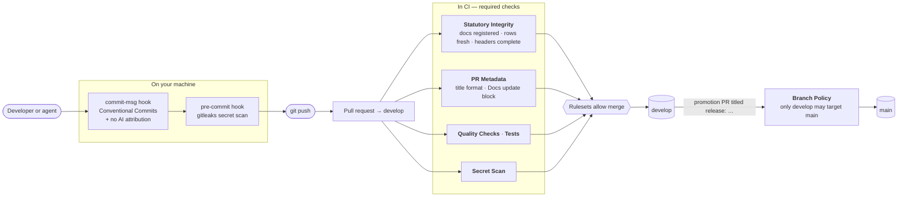
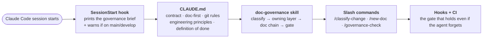

# Concepts

What `repo-governance` generates, and the rules the generated repos enforce.

- [What gets generated](#what-gets-generated)
- [The documentation layers](#the-documentation-layers)
- [How a change flows](#how-a-change-flows)
- [How the rules are enforced](#how-the-rules-are-enforced)
- [How coding agents are kept on the rails](#how-coding-agents-are-kept-on-the-rails)
- [Repository types](#repository-types)

## What gets generated

Every repo is already a git repository on `main`, with one initial commit, a `develop` branch, and `core.hooksPath` pointed at `.githooks`.

## The documentation layers

Each layer owns **one** kind of decision. Cross-layer *links* are encouraged; cross-layer *ownership duplication* is forbidden.

| Layer | Owns | Typical artifacts |
|---|---|---|
| **L0** | How artifacts are written and governed | naming rules, change-propagation, engineering principles |
| **L1** | Why the product exists; how success is measured | vision, ICP, market, positioning |
| **L2** | What must be built | PRDs, feature briefs, roadmap |
| **L2.5** | How it behaves and feels | user flows, wireframes, design system |
| **L3** | How it is engineered | system architecture, API contracts, data model, security, ADRs |
| **L4** | How it is provisioned and deployed | environments, CI/CD, runbooks, cost |
| **L5** | How it is tested, operated, supported | test playbook, incident runbooks, launch |
| **L6** *(regulated)* | What was found broken | `R-NNN` audit + plan per session |
| **L6.1** *(regulated)* | What was done, with proof | tactical checklist + walkthrough evidence |
| **L7** *(regulated)* | The permanent record | master registry: finding → plan → evidence → merged PR |

## How a change flows

The **Golden Rule**: *the layer that owns the problem gets the first edit. Downstream layers sync to it — never the reverse.*

**Doc-first table** (also in every generated `CLAUDE.md`):

| Work type | Docs that must exist before the first line of code |
|---|---|
| New feature | L2 brief → L3 spec (API / data model) → L5 test-playbook section |
| Defect remediation *(regulated)* | L6 audit → L6 plan → implement → L6.1 execution → L6.1 evidence → L7 row |
| Infrastructure change | L4 runbook section → L3 ADR if it introduces a new pattern |
| Strategy / pricing / GTM | L1 doc → L2 PRD if product scope follows |

## How the rules are enforced

A rule that is only written down gets broken. Every rule here has a mechanism.

| Rule | Mechanism |
|---|---|
| Every doc is registered; no stale rows; versions/dates match each file | `bin/statutory-integrity.sh` → CI `Statutory Integrity` |
| Complete document headers; Document ID equals filename | same gate, strict mode |
| PR title is a Conventional Commit; promotion PRs start `release:` | CI `PR Metadata` |
| PR body has `- Status: UPDATED/EXEMPT` and real `- Notes:` | CI `PR Metadata` |
| Commit subject is a Conventional Commit | `.githooks/commit-msg` |
| No AI attribution in commits or PR text *(optional)* | `commit-msg` hook + CI |
| No secrets committed | `pre-commit` + CI `Secret Scan` |
| `main` only receives `develop` | CI `Branch Policy` (rulesets can't see a PR's source branch) |
| PR-only, no force-push, squash/rebase on `develop`, merge-commit on `main`, no deletion | three GitHub **rulesets** applied by `gov github` |

> **Strict vs adoption mode.** New repos are generated strict (`.governance/sive.json` → `{ "strict": true }`): every header and registry problem fails the build. When you adopt the gate into an existing repo, it starts in *adoption mode*: unregistered docs still fail, but header and stale-row findings are warnings, so you can switch CI on without rewriting history first. Flip to strict once the registries are clean.

## How coding agents are kept on the rails

Instructions in a file get forgotten mid-session. So every generated repo layers four mechanisms:

What the agent is told, in every repo, before any change:

1. **Classify the change** — strategic, product, engineering or operational.
2. **Edit the owning layer first.** Downstream docs and code follow.
3. **Doc-first.** If the chain is missing, write and register it before code.
4. **Register every doc**; keep registry rows' versions and dates accurate.
5. **Update the CHANGELOG**; README if setup or public behaviour changed.
6. **Run the gate** before saying "done".
7. **Commit and push only when the user asks.** Never branch without asking.
8. **Engineering principles:** modular boundaries · never duplicate code · one source of truth per fact · centralised design tokens · shipped clients never fall back to localhost · verify before asserting · fix now, don't defer.

The full text of the principles — with the *reason* behind each — is `docs/L0-foundation/L0-009-engineering-principles-v1.md`. Rules without reasons get deleted by the next person who finds them inconvenient; each one here records the failure it prevents.

## Repository types

| Type | Use it for | Doc layers | Notes |
|---|---|---|---|
| **`product`** | The main codebase: apps, services, shared packages | L0–L5 *(+ L6, L6.1, L7 if regulated)* | Usually holds the org's L0 standards. Gets the long-form `CLAUDE.md` with testing, definition of done and engineering principles. |
| **`site`** | A public website | L3 *(+ L6, L6.1, L7 if regulated)* | Points at the standards repo for L0. Has its own audits and its own chain of custody. |
| **`assets`** | Brand and static media | none | The **source of truth for the brand**: logos, palette, fonts, media. Other repos take their brand from here. Declare anything it must follow with `follows`. |
| **`package`** | Shared content or library consumed by other repos via a pinned tag | none | The single place a fact is edited; consumers bump their pin. |

Each repo that runs remediation keeps its **own** L6 → L6.1 → L7 chain; session numbers are per-repo, so cite another repo's session as "website R-012".
