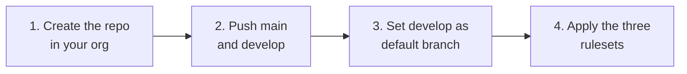

# Usage

Prerequisites: Node ≥ 20, git; `gh` (authenticated) only for `--github`. Check with `node bin/gov.mjs doctor`.

## 0. Interactive (easiest)

```bash
pnpm generate        # same as: node bin/gov.mjs create   (aliases: generate, init)
```

Asks for: organisation name, header owner, GitHub org, the folder to scaffold into, regulated or not, integration branch, AI-attribution rule, then each repository (name, type, description, what it follows, what it is the source of truth for), which repo holds the L0 standards, package manager and Node version, and whether to publish to GitHub. Shows a summary and asks before writing anything; answering `n` at the end writes nothing.

## 1. New organisation (non-interactive)

```bash
cp examples/new-org.governance.json my-org.json     # edit org + repos
node bin/gov.mjs new-org ~/code/my-org --config my-org.json
# or flags:
node bin/gov.mjs new-org ~/code/my-org --name "Example Org" --repos platform:product,website:site,assets:assets --regulated
```

Creates `~/code/my-org/{governance.json, platform/, website/, assets/}`; each repo is `git init`-ed on `main` with one commit, a `develop` branch, hooks path set, and a passing governance gate. Add `--dry-run` to preview.

### Publishing to GitHub (outward-facing — always confirmed)

**Automatic (recommended).** Answer `y` to *"Create the repos on GitHub and apply branch rulesets now?"* in the wizard (or pass `--github` to `new-org`). For each repo it runs, **in this order**:



The order is not negotiable: the rulesets make `main` and `develop` PR-only, so they would reject the very first push if applied before it. The plan is printed and you confirm before anything happens; `new-org … --github --yes` skips the prompt for unattended runs.

**Manual, or finishing a repo you already pushed.** If you answered `n`, created the repo yourself, or only pushed `main`:

```bash
# one command: creates the repo if missing, pushes main + develop (never resets an existing develop),
# sets the default branch, applies the rulesets
node bin/gov.mjs github ~/code/example-org/platform
```

Doing it by hand instead is the same four steps:

```bash
gh repo create example-org/platform --private          # 1. skip if it exists
git push -u origin main && git push -u origin develop  # 2. both branches
gh repo edit example-org/platform --default-branch develop   # 3.
node bin/gov.mjs github ~/code/example-org/platform --rulesets-only   # 4.
```

> **Plan limit.** Rulesets need a paid GitHub plan (Team/Pro) for private repos, or a public repo. On a free plan step 4 is reported and skipped; everything else works, but branch protection is **not enforced** until you upgrade and re-run `--rulesets-only`.

## 2. Add a repo later

```bash
node bin/gov.mjs add-repo mobile-kit --profile package --org-dir ~/code/my-org --description "Shared kit"
```

Every sibling's `Sibling repositories` section and `L0-010` topology refresh automatically.

## 3. Adopt into an existing repo

```bash
node bin/gov.mjs adopt ~/code/my-repo --config governance.json --repo platform --dry-run
node bin/gov.mjs adopt ~/code/my-repo --config governance.json --repo platform
```

Writes missing **managed** files; where a managed file already exists and differs, writes `<file>.governance-new` for review and touches nothing. Docs, `CLAUDE.md`, README and CHANGELOG are untouched unless you pass `--docs` (and even then only if absent).

## 4. Keep repos current

```bash
node bin/gov.mjs sync ~/code/my-org/platform --check     # exit 1 on drift (use in a scheduled job)
node bin/gov.mjs sync ~/code/my-org/platform             # apply
```

Rules: untouched managed files update; edited ones become `.governance-new`; `--force` overwrites; seeded files are never rewritten except their `gov:begin/end` regions; improved L0 standards are reported as **ADVISORY** (diff and merge by hand — they carry your registry rows).

**How `sync` treats files**

| File kind | Examples | On sync |
|---|---|---|
| **Managed** | hooks, workflows, gate script, rulesets, the skill and commands | Updated if you haven't touched it; if you *have*, the new version is written beside it as `<file>.governance-new` for you to review. |
| **Seeded** | `CLAUDE.md`, README, CHANGELOG, `docs/` | Written once, then yours. Only the marked `gov:begin … gov:end` regions (sibling lists, layer tables, repo topology) are refreshed. |
| **Advisory** | L0 standards you've edited | Reported as "template has a newer version" — you merge by hand, because they carry your registry rows. |

## 5. After generating

```bash
cd my-org/platform
bash bin/install-hooks.sh                 # commit-msg + pre-commit
bash bin/statutory-integrity.sh           # the gate CI runs
```

Then fill the `TODO`s in `CLAUDE.md` (project, stack, apps map) — the agent navigates by them.

## Config reference (`governance.json`)

Everything the wizard asks is saved to `governance.json`, so you can skip the wizard next time.

```json
{
  "org": {
    "name": "Example Org",
    "github": "example-org",
    "owner": "Example Org",
    "regulated": false,
    "standardsRepo": "platform",
    "defaultBranch": "develop"
  },
  "rules": { "noAiAttribution": true, "releasePrTitle": "release" },
  "stack": { "packageManager": "pnpm", "node": "22.15.0", "pnpm": "9.15.9" },
  "repos": [
    { "name": "platform", "profile": "product", "description": "…", "owns": ["API contracts"] },
    { "name": "website",  "profile": "site",    "follows": ["platform"] }
  ]
}
```

| Key | Meaning | Default |
|---|---|---|
| `org.name`, `github`, `owner`, `copyright`, `license` | Identity used in headers and docs | owner/copyright = org name; license `Proprietary` |
| `org.regulated` | Adds L6, L6.1, L7 | `false` |
| `org.standardsRepo` | The one repo that holds L0 | first `product` repo |
| `org.defaultBranch` | Integration branch | `develop` |
| `org.requiredReviews` | Approvals the rulesets require | `0` |
| `org.codeowners` | e.g. `@example-org/maintainers` → `.github/CODEOWNERS` | none |
| `layerFolders` | Rename a layer folder, e.g. `{ "L3": "L3-engineering" }` | defaults |
| `rules.noAiAttribution` | Hook + CI block AI attribution | `true` |
| `rules.releasePrTitle` | Prefix for `develop`→`main` PR titles | `release` |
| `rules.requireDocsUpdate` | CI requires the `## Docs update` block; PRs opened by `dependabot[bot]` are exempt | `true` |
| `commands` | install / lint / typeCheck / test | pnpm defaults |
| `repos[].profile` | `product` · `site` · `assets` · `package` | required |
| `repos[].follows` / `owns` | Source-of-truth direction | none |
| `repos[].layers` | Override the type's default layers | type default |

## Extending

- **New profile**: `profiles/<name>/profile.json` (`role`, `layers`, `regulatedLayers`, `requiredChecks`, `managed`, `conditional`, `exclude`) + `files/`.
- **New standard doc**: add `LL-NNN-slug-v1.md` under the profile's `files/docs/<layer>/` — registries pick it up automatically. Bump its header `Version` when you improve it so `sync` advises.
- **New check**: add the workflow job, its `name` to `requiredChecks`, run tests.
